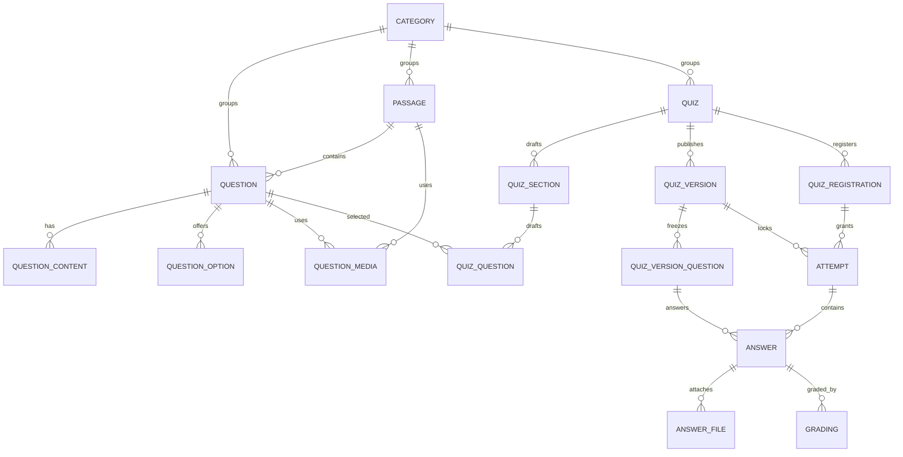
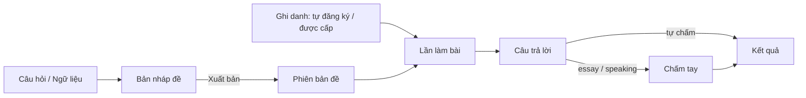

# MIỀN NGHIỆP VỤ ASSESSMENT

Version: 2.0

Document Status: Approved

Implementation Status: Partial

Last Updated: 2026-11-06

Document Path: database/assessment/README.md

> Thiết kế theo [ADR-0003](../../adr/ADR-0003-Assessment-Foundation.md) và
> [ADR-0025](../../adr/ADR-0025-Assessment-Simple-Administration.md) (Approved
> 2026-11-06). Owner duyệt tài liệu bảng giai đoạn 1 trong hội thoại ngày
> 2026-11-06 (không lập tài liệu Architecture Review riêng, như tiền lệ
> ADR-0021). Migration giai đoạn 1 đã có
> (`2026_11_06_000100`–`000300`), kiểm trên MariaDB 11.4; service, route và giao
> diện chưa có, nên Implementation Status là `Partial`.

Miền Assessment quản lý module **Kiểm tra**: danh mục, câu hỏi, ngữ liệu, đề /
bài tập, phiên bản xuất bản, ghi danh, lần làm bài, câu trả lời và chấm điểm.
Miền này tạo bằng chứng đánh giá; không tự đổi trạng thái của miền khác.

---

## Tổng quan

- **Trách nhiệm:** soạn câu hỏi, ghép đề, xuất bản đề, cho học viên làm bài,
  chấm và lưu kết quả đáng tin cậy.
- **Sở hữu:** nguồn soạn thảo, phiên bản đề đã xuất bản, ghi danh vào đề, bài
  làm và kết quả chấm.
- **Không sở hữu:** file (Media), thanh toán, Course Progress / Completion,
  Certificate.
- **Miền liên quan:** Media, Người dùng và Tenant; sau này Course (gắn đề / gói
  vào khoá học) và Product (bán đề).

---

## Bảng giai đoạn 1

### 1. Nguồn soạn thảo

| Bảng | Mô tả |
|------|------|
| [core_assessment_categories](core_assessment_categories.md) | Cây danh mục ("nhóm câu hỏi") |
| [core_assessment_passages](core_assessment_passages.md) | Ngữ liệu: đoạn đọc / bài nghe có nhiều câu con |
| [core_assessment_questions](core_assessment_questions.md) | Câu hỏi |
| [core_assessment_question_contents](core_assessment_question_contents.md) | Đề bài, giải thích, đáp án mẫu |
| [core_assessment_question_options](core_assessment_question_options.md) | Lựa chọn và đáp án chấp nhận |
| [core_assessment_question_media](core_assessment_question_media.md) | Media của câu hỏi hoặc ngữ liệu |

### 2. Đề và phiên bản

| Bảng | Mô tả |
|------|------|
| [core_assessment_quizzes](core_assessment_quizzes.md) | Bản nháp đề / bài tập, dùng lại được |
| [core_assessment_quiz_sections](core_assessment_quiz_sections.md) | Phần của bản nháp |
| [core_assessment_quiz_questions](core_assessment_quiz_questions.md) | Câu trong bản nháp |
| [core_assessment_quiz_versions](core_assessment_quiz_versions.md) | Phiên bản xuất bản bất biến |
| [core_assessment_quiz_version_questions](core_assessment_quiz_version_questions.md) | Câu đã đóng băng trong phiên bản |

### 3. Ghi danh, làm bài, chấm

| Bảng | Mô tả |
|------|------|
| [core_assessment_quiz_registrations](core_assessment_quiz_registrations.md) | Ghi danh học viên vào đề, đếm lượt |
| [core_assessment_attempts](core_assessment_attempts.md) | Lần làm bài |
| [core_assessment_answers](core_assessment_answers.md) | Câu trả lời |
| [core_assessment_answer_files](core_assessment_answer_files.md) | File ghi âm Speaking |
| [core_assessment_gradings](core_assessment_gradings.md) | Lịch sử chấm tay theo câu |

## Bảng hoãn (không có migration ở giai đoạn 1)

| Bảng | Lý do |
|------|------|
| [core_assessment_question_banks](core_assessment_question_banks.md) | Câu hỏi thuộc người tạo, phân loại bằng danh mục |
| [core_assessment_topics](core_assessment_topics.md) | Danh mục đủ cho giai đoạn 1 |
| [core_assessment_question_topics](core_assessment_question_topics.md) | Như trên |
| [core_assessment_rubrics](core_assessment_rubrics.md) | Chấm điểm + nhận xét là đủ |
| [core_assessment_rubric_items](core_assessment_rubric_items.md) | Như trên |
| [core_assessment_grading_assignments](core_assessment_grading_assignments.md) | Người chấm suy ra từ người tạo / người cấp |

---

## Sơ đồ quan hệ

---

## Luồng nghiệp vụ

---

## Nguyên tắc thiết kế

- Mọi bảng có `customer_id`; khoá ngoại nội bộ dùng khoá kép
  `(id, customer_id)` để chặn tham chiếu chéo tenant ở database.
- Khoá ngoại mặc định `RESTRICT`; `CASCADE` chỉ cho phần con của nguồn soạn
  thảo (nội dung, lựa chọn, media của câu / ngữ liệu; phần và câu của bản nháp
  đề).
- Nguồn soạn thảo sửa được; phiên bản đề bất biến; lần làm bài khoá phiên bản và
  chỉ đọc snapshot.
- Đáp án đúng và giải thích không gửi cho học viên trước khi lần làm bài kết
  thúc.
- Chấm, giờ làm bài và số lượt đều do server quyết.
- Câu hỏi, ngữ liệu, đề đã vào một phiên bản chỉ được lưu trữ, không xoá cứng.
- Mọi điểm là `DECIMAL`.
- File thuộc Media; Assessment chỉ lưu `media_file_id` và ghi `media_file_usages`.
- Giáo viên thấy và sửa nguồn soạn thảo của mình; admin thấy mọi thứ trong
  tenant.
